# Gophish Practical: Building and Reviewing a Local Awareness Campaign

## Practical summary

This exercise demonstrates how a phishing-awareness campaign can be assembled and tested in a closed laboratory setup. Gophish was used for campaign preparation and reporting. Mailpit received the generated messages locally, allowing the email content and delivery configuration to be checked without using an external mailbox.

**Test environment:** Kali Linux  
**Mail testing utility:** Mailpit  
**Campaign recipient:** `student@lab.local`  
**Landing page:** Security Awareness Training

## Purpose of the exercise

The practical followed the lifecycle of a basic awareness simulation: prepare a local mail-capture service, connect Gophish to it, build the message and destination page, register a controlled test recipient, and inspect the campaign report.

The landing page was informational. The setting for capturing submitted data was left disabled, and no password collection was configured.

## Practical record

### Part 1: Prepare the local email-testing service

Mailpit was installed on Kali Linux. The installation output confirmed that the program was placed on the system, and its browser interface was opened on port `8025`.

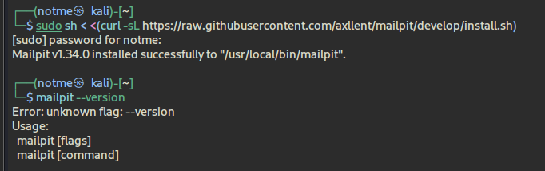

*Evidence 1: Mailpit installation completed on the Kali machine.*

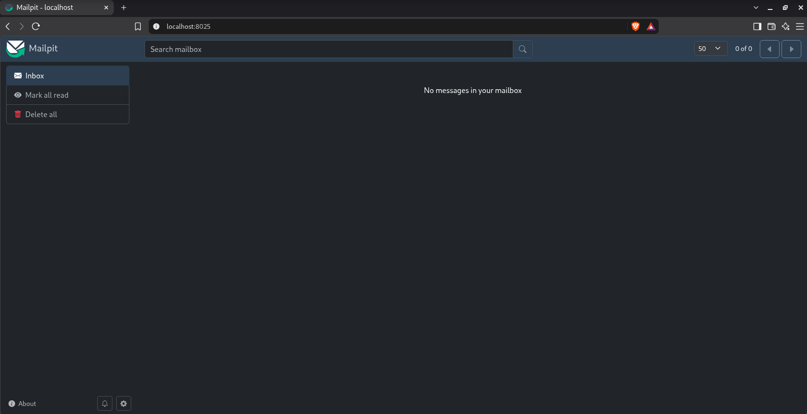

*Evidence 2: Local Mailpit inbox opened and ready to receive test messages.*

### Part 2: Connect Gophish to Mailpit

A Gophish sending profile named **Mailpit** was added. SMTP was selected as the interface type, with `127.0.0.1:1025` entered as the host. The sender identity was set to `training@lab.local`.

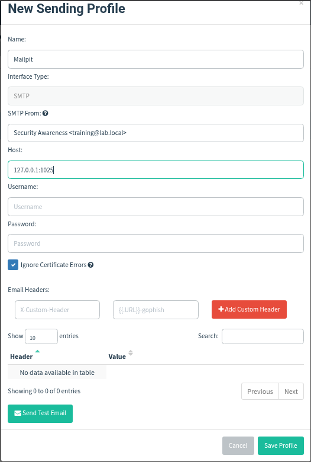

*Evidence 3: Local SMTP host and sender information entered in the profile.*

The first test was rejected because the FROM parameter was invalid. After correcting the sender details, the test email was accepted and appeared in Mailpit.

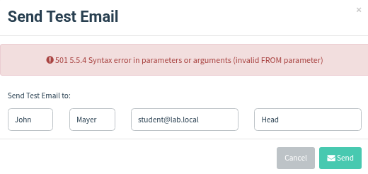

*Evidence 4: Error returned by the first sending-profile test.*

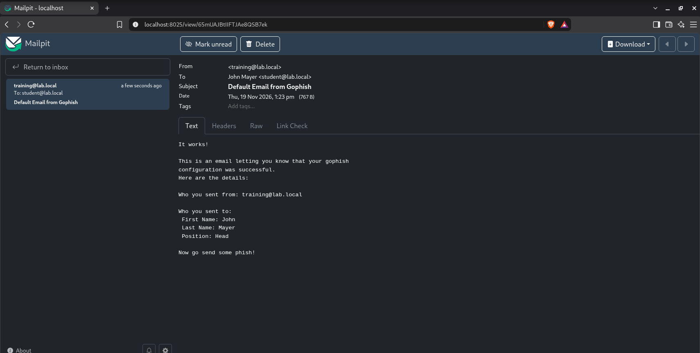

*Evidence 5: Mailpit showing the test message after the sender correction.*

The profile was saved after the successful test.

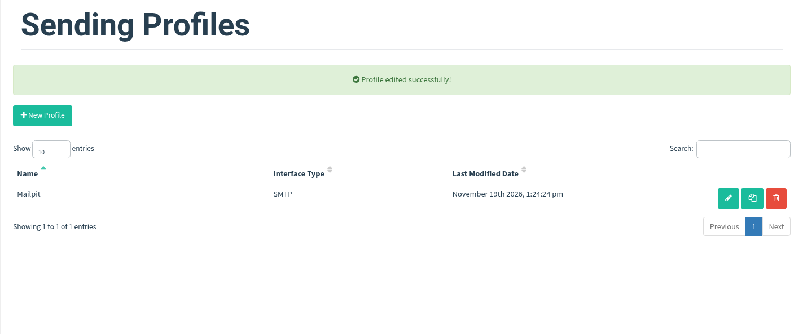

*Evidence 6: Mailpit profile present in the Gophish sending-profile list.*

### Part 3: Build the awareness message

The email template was named **IT Security Awareness** and used the subject **Important: Security Awareness Test**. Its HTML content described the exercise and provided a link placeholder for the training destination. It also reminded the recipient not to enter passwords or sensitive details on unverified pages.

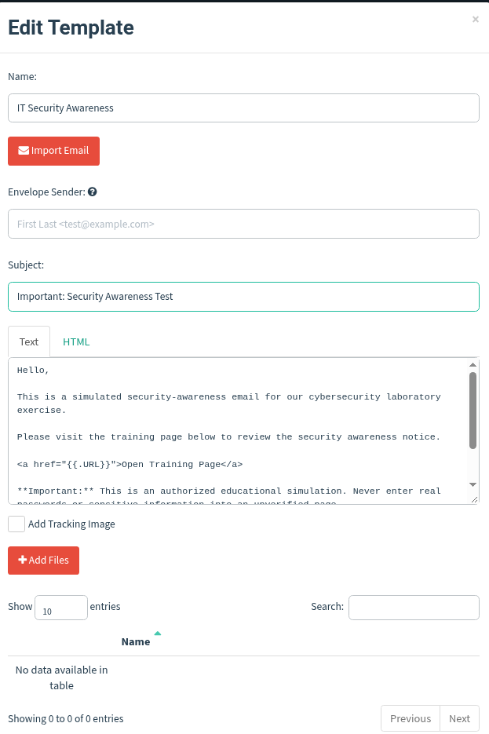

*Evidence 7: Awareness email written in the Gophish template editor.*

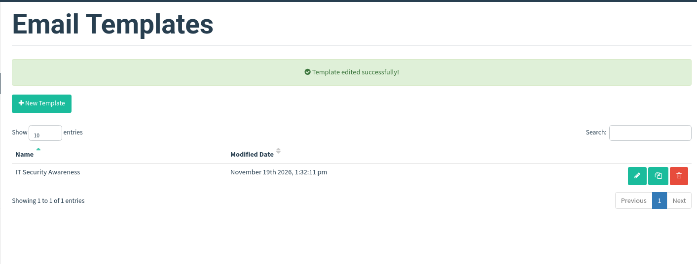

*Evidence 8: Template stored and visible in the email-template list.*

### Part 4: Add the training destination

The page **Security Awareness Training** was created as the destination for the campaign link. Its content explained that the visitor had reached a simulated training page and highlighted the importance of checking links before opening them.

The option to capture submitted data remained unchecked.

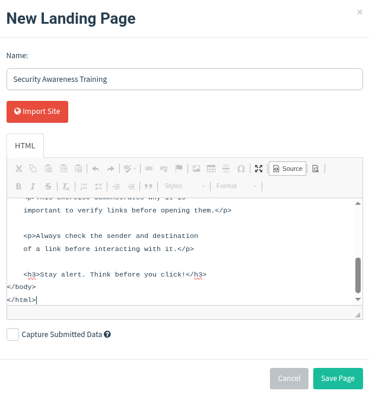

*Evidence 9: Training-page content entered with data capture disabled.*

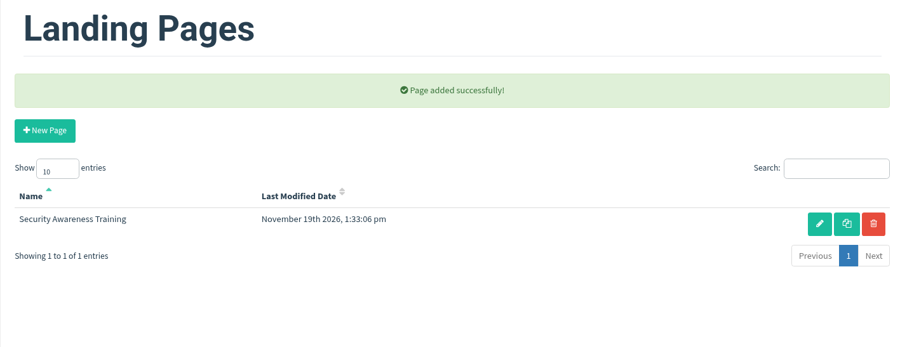

*Evidence 10: Gophish confirming that the landing page was added.*

### Part 5: Define the test audience

A group called **Lab Test Group** was created for the exercise. It contained one laboratory identity, `Student Test`, with the address `student@lab.local` and the position Cybersecurity Student.

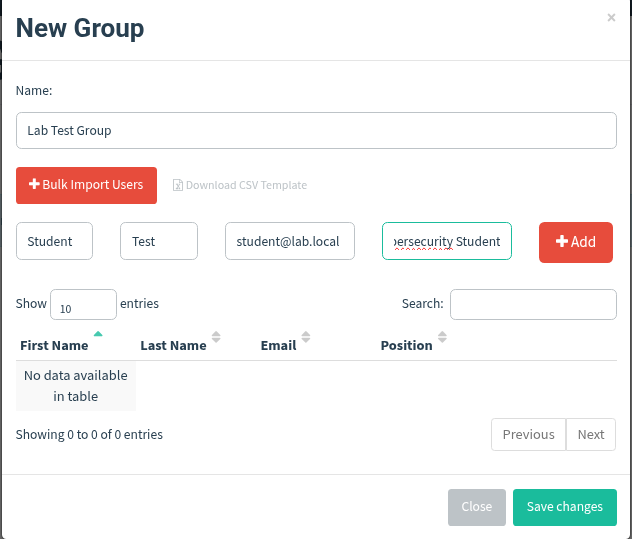

*Evidence 11: Test identity entered in the new-group form.*

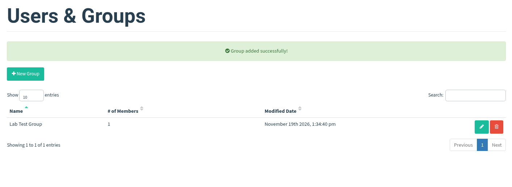

*Evidence 12: Group overview showing one registered member.*

### Part 6: Assemble and run the campaign

The campaign was named **Lab Phishing Simulation**. The saved template, training page, Mailpit profile, and Lab Test Group were selected.

| Setting | Value used |
|---|---|
| Campaign name | Lab Phishing Simulation |
| Email template | IT Security Awareness |
| Landing page | Security Awareness Training |
| Sending profile | Mailpit |
| Recipient group | Lab Test Group |
| Campaign URL | `http://127.0.0.1` |

The URL pointed to the local Gophish phishing listener on port 80. It was kept separate from the administration interface, which used port 3333.

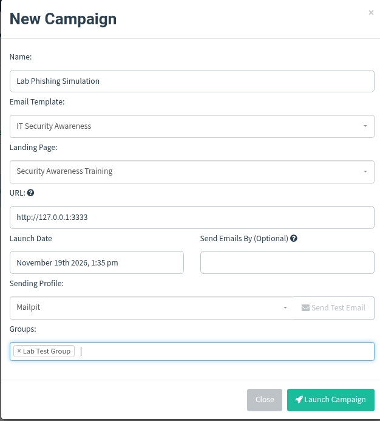

*Evidence 13: Campaign configuration reviewed before it was started.*

Once launched, the results page showed one email sent. The recipient's row displayed the status **Email Sent**.

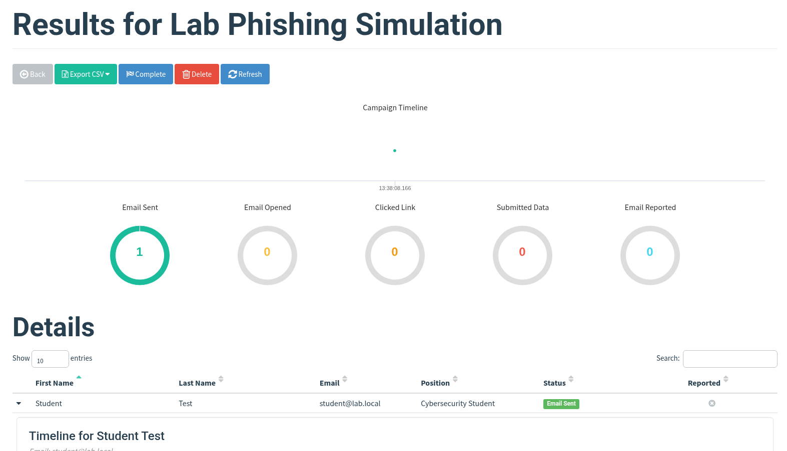

*Evidence 14: Gophish results page showing the send event for the test recipient.*

### Part 7: Check the message and campaign activity

The generated email was opened in Mailpit. Its sender, recipient, subject, and rendered HTML body were checked. The **Open Training Page** link was present in the message.

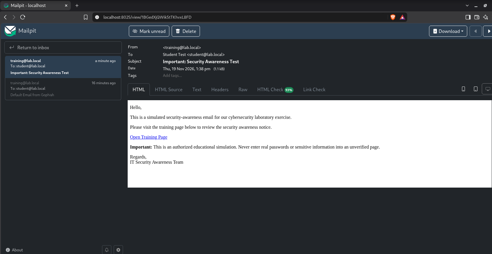

*Evidence 15: Delivered campaign email displayed in Mailpit.*

Add the screenshot showing the local training page after following the link.

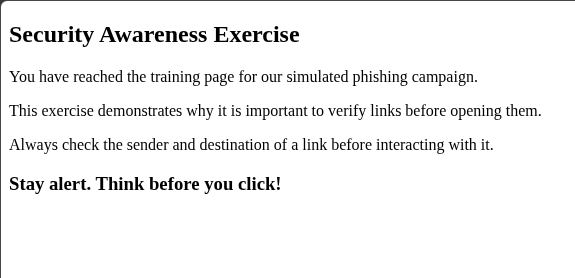

*Evidence 16: Local awareness page opened from the message link. Screenshot to be added.*

After testing, refresh the campaign report and insert the final dashboard screenshot. Report only the event totals visible in that final image.

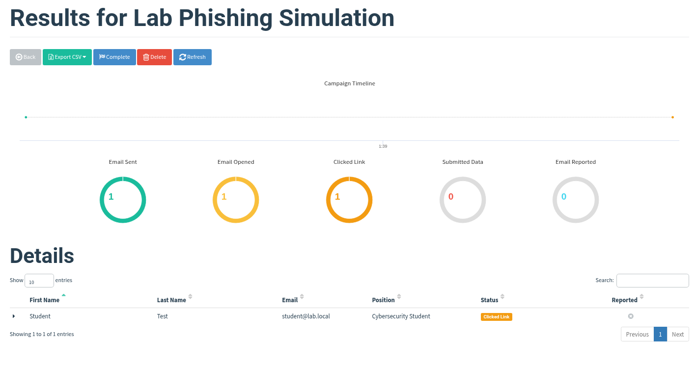

*Evidence 17: Updated Gophish event report after the link test. Screenshot to be added.*

## Observations and findings

1. Mailpit provided a local destination for SMTP test messages.
2. The first sender-profile test failed because of an invalid FROM parameter. The corrected sender details allowed the test message to arrive.
3. The Gophish components were saved: one sending profile, one email template, one landing page, and one recipient group.
4. The campaign was run against a single laboratory recipient.
5. Mailpit displayed the campaign email and its HTML content.
6. The landing page was intended for awareness training, not credential collection.
7. Delivery, opening, and link-click events are separate measurements. The Gophish report, rather than the Mailpit inbox alone, must be used to confirm which events were recorded.

## Conclusion

The practical demonstrated the setup of a local phishing-awareness simulation with Gophish and Mailpit. A test email was sent to the local capture service, and the campaign report provided a way to inspect activity for the single test recipient. The exercise also demonstrated why controlled recipients, a non-credential-collecting landing page, and a local mail-testing service are appropriate for a classroom simulation.

